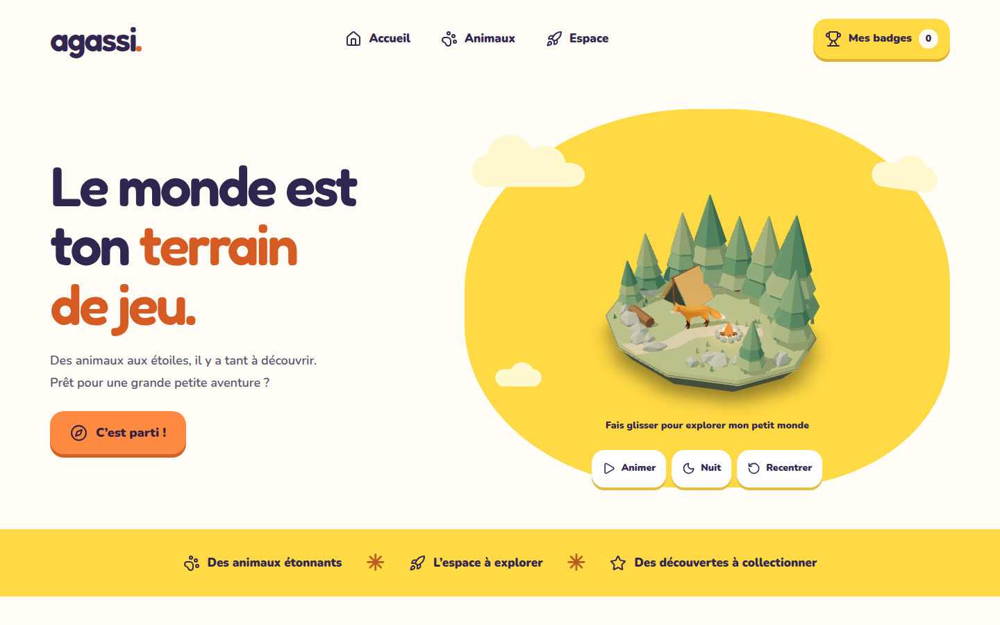
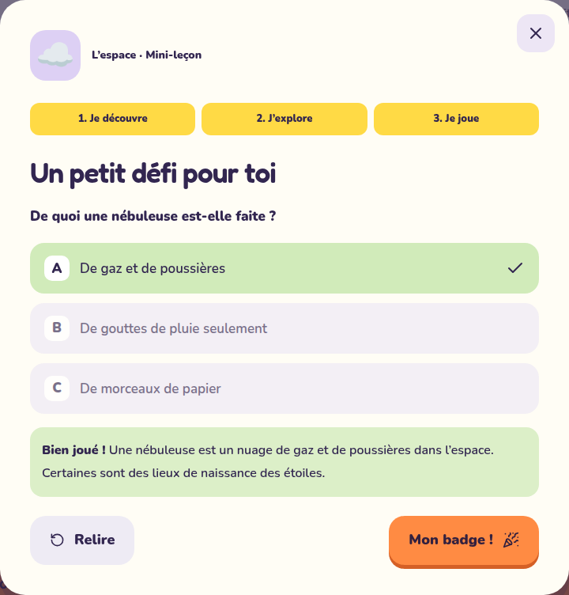
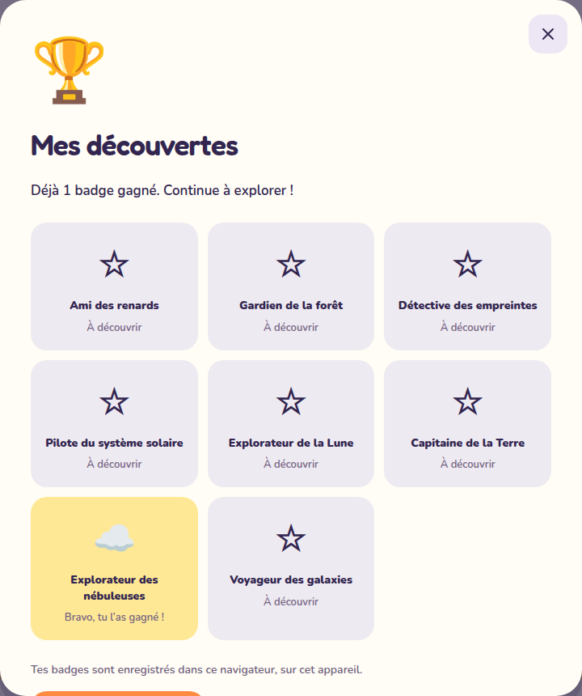
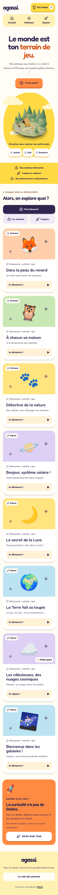

<div align="center">

# agassi.

**Le monde est ton terrain de jeu.**

Une plateforme éducative interactive en français pour les enfants de **6 à 10 ans**. Des animaux aux étoiles : découvrir, expérimenter et apprendre en jouant.

**Next.js · React · TypeScript · Three.js · GSAP**

[Découvrir le projet](#découvrir-agassi) · [Installation](#installation) · [Les leçons](#les-leçons) · [Crédits](#crédits-et-ressources)

</div>



## Découvrir Agassi

Agassi associe un univers 3D à des leçons courtes, des activités et des quiz. Le renard **Rouxy** accueille les enfants dans son campement forestier, avant de les accompagner vers deux univers : **les animaux** et **l’espace**.

- **8 leçons originales**, chacune avec une découverte, une activité et un quiz expliqué.
- **Des badges à collectionner**, enregistrés dans le navigateur sans créer de compte.
- **Un campement 3D interactif** : renard animé au repos, feu de camp, tente et forêt.
- **Des contrôles simples** : tourner autour du décor, zoomer dans des limites adaptées, recentrer, mettre en pause et passer du jour à la nuit.
- **Une interface pour les enfants** : grands boutons, menus lisibles, couleurs unies jaunes et orange.
- **Des transitions GSAP** pour l’arrivée des éléments, les filtres et les étapes des leçons.
- **Un coin des parents** avec les sources pédagogiques et les crédits.

## Aperçus

### Un quiz pour comprendre

L’enfant peut réessayer ou relire la leçon. Une bonne réponse affiche une explication, puis débloque un badge.



### Une collection de découvertes



<details>
<summary>Voir la version mobile</summary>

<p align="center">
  
</p>

</details>

Les captures proviennent de l’application locale. Les badges montrés illustrent une progression de démonstration.

## Les leçons

| Univers | Leçon | Ce que l’enfant découvre |
| --- | --- | --- |
| Animaux | Dans la peau du renard | Les mammifères, l’alimentation et les sens du renard |
| Animaux | À chacun sa maison | Les habitats et les besoins des animaux |
| Animaux | Détective de la nature | Les traces et l’observation respectueuse des animaux |
| Espace | Bonjour, système solaire ! | Le Soleil, les huit planètes et les orbites |
| Espace | Le secret de la Lune | La lumière réfléchie et les phases de la Lune |
| Espace | La Terre fait sa toupie | La rotation de la Terre et l’alternance jour/nuit |
| Espace | Les nébuleuses, des nuages cosmiques | Les nuages de gaz et de poussières et la naissance d’étoiles |
| Espace | Bienvenue dans les galaxies ! | Les galaxies et notre Voie lactée |

Les activités sont proposées sans chronomètre. Un adulte peut accompagner la lecture et les expériences.

## Installation

### Prérequis

- **Node.js 20.9 ou supérieur** — Node.js 24 a été utilisé pour le développement.
- **npm**.
- Un navigateur récent compatible **WebGL** pour afficher la scène 3D.

Depuis le dossier du projet :

```bash
npm ci
npm run dev
```

Ouvrir l’adresse indiquée dans le terminal, généralement **http://localhost:3000**. Next.js choisit un autre port si celui-ci est occupé.

Aucune variable d’environnement, base de données ou clé Sketchfab n’est nécessaire pour lancer l’application. Les modèles 3D sont inclus dans le projet. Blender et sa connexion MCP ont servi à préparer les modèles ; ils ne sont pas nécessaires pour exécuter le site.

### Commandes

| Commande | Description |
| --- | --- |
| `npm run dev` | Démarrer le serveur de développement |
| `npm run typecheck` | Vérifier les types TypeScript |
| `npm run build` | Compiler l’application pour la production |
| `npm start` | Démarrer le serveur de production après compilation |

```bash
npm run typecheck
npm run build
npm start
```

## Technologies

| Technologie | Utilisation |
| --- | --- |
| Next.js 16 / App Router | Structure de l’application et rendu des pages |
| React 19 et TypeScript | Composants et interactions |
| Three.js, React Three Fiber et Drei | Scène 3D, modèles GLB et animation du renard |
| GSAP | Transitions de l’interface avec nettoyage au démontage |
| Lucide React | Icônes de navigation et de contrôle |
| CSS | Mise en page responsive et thème enfant |
| Blender MCP et Sketchfab | Import du renard, préparation de l’animation et export des modèles |

## Organisation du projet

```text
app/
  globals.css              # Styles et adaptations mobile
  icon.svg                 # Favicon Agassi
  layout.tsx               # Mise en page racine et métadonnées
  page.tsx                 # Page d’accueil
components/
  agassi.tsx               # Navigation, catalogue, badges et coin des parents
  lesson-dialog.tsx        # Étapes de leçon, quiz et dialogues
  scene.tsx                # Scène 3D, animation et contrôles caméra
lib/
  lessons.ts               # Contenu pédagogique des huit leçons
public/models/
  fox.glb                  # Renard riggé avec animation idle
  camp.glb                 # Décor du campement
assets/
  wildcamp.blend           # Source Blender modifiable (nom historique)
scripts/
  build_scene.py           # Script de préparation de la scène Blender
docs/screenshots/
  agassi-*.png              # Captures utilisées dans ce README
```

### Ajouter une leçon

Ajouter une entrée dans `lib/lessons.ts` en respectant le type `Lesson` : identifiant unique, univers, titre, deux informations, activité, question, trois réponses, index de la bonne réponse, explication et nom du badge.

Le catalogue, les filtres, le nombre de leçons et la collection de badges utilisent cette liste. Aucune nouvelle page n’est nécessaire.

## Progression et accessibilité

- La progression est stockée dans `localStorage`, sous la clé **`agassi-badges`**. Elle reste propre au navigateur et à l’appareil ; elle n’est pas synchronisée.
- Si le stockage est indisponible, les badges restent en mémoire pendant la visite. Effacer les données du site supprime les badges enregistrés.
- La préférence système de réduction des animations désactive les transitions GSAP et met initialement la scène en pause.
- Les dialogues utilisent l’élément natif `dialog`, avec gestion du focus et fermeture par **Échap**.
- La navigation comporte un lien d’évitement et des indicateurs de focus visibles.
- Les polices Fredoka et Nunito sont chargées depuis Google Fonts, avec des alternatives système. Les liens NASA et Sketchfab ouvrent des sites externes.

## Modèles 3D

Le renard a été importé depuis Sketchfab via Blender MCP. Sa taille a été normalisée et la séquence idle extraite des images 1 à 140, à 24 images par seconde. Elle est jouée en aller-retour pour éviter une coupure brutale au raccord.

Le décor forestier a été construit dans Blender puis exporté séparément. Le zoom est limité selon le format du canvas pour conserver le campement dans le cadre.

`assets/wildcamp.blend` contient la scène modifiable. `scripts/build_scene.py` documente sa construction après l’import Sketchfab : ce script n’est pas idempotent et ne doit pas être relancé tel quel sur la scène finale. Son chemin de sortie doit être adapté à votre machine.

## Crédits et ressources

### Renard

**PixelMannen** — modèle ; **tomkranis** — rig et animation.

- [Low poly fox by PixelMannen (Animated) sur Sketchfab](https://sketchfab.com/3d-models/371dea88d7e04a76af5763f2a36866bc)
- [Modèle d’origine sur OpenGameArt](https://opengameart.org/content/fox-and-shiba)
- [Licence Creative Commons Attribution 4.0](https://creativecommons.org/licenses/by/4.0/)

Modifications : normalisation de la taille, découpage de l’animation et export GLB. Conserver cette attribution lors de la redistribution du modèle.

### Ressources pédagogiques

Les leçons sont rédigées en français pour Agassi. Le coin des parents propose notamment ces références :

- [Système solaire — NASA Science](https://science.nasa.gov/solar-system/solar-system-facts/)
- [Phases de la Lune — NASA Science](https://science.nasa.gov/moon/moon-phases/)
- [La Terre — NASA Science](https://science.nasa.gov/earth/facts/)
- [Nébuleuses — NASA Space Place](https://spaceplace.nasa.gov/nebula/en/)
- [Galaxies — NASA Space Place](https://spaceplace.nasa.gov/galactic-explorer/en/)
- [NASA Kids’ Club](https://www.nasa.gov/learning-resources/nasa-kids-club/)

**Agassi est un projet indépendant, non affilié à la NASA.**

### Licence du code

Aucune licence de distribution du code n’est définie dans ce dépôt à ce stade. La licence CC BY 4.0 mentionnée ci-dessus concerne le modèle du renard.
